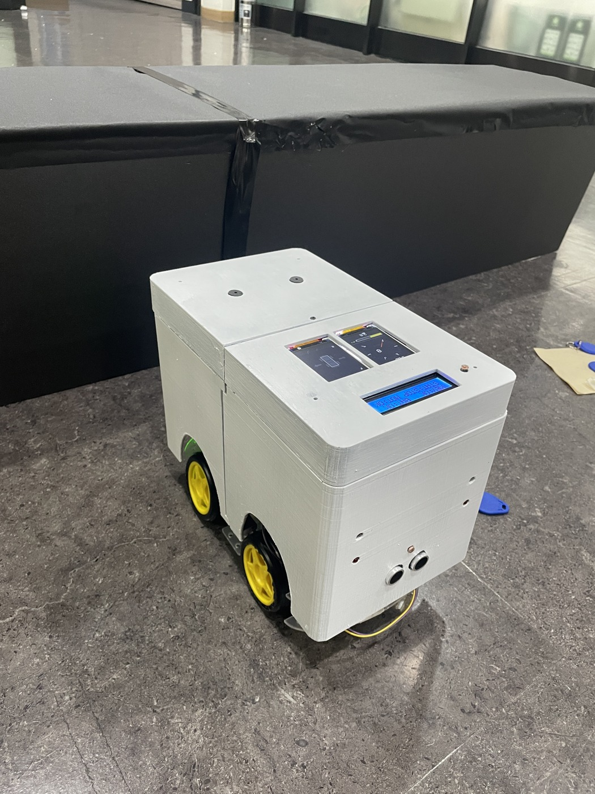
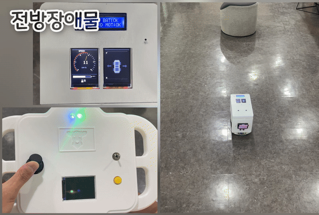
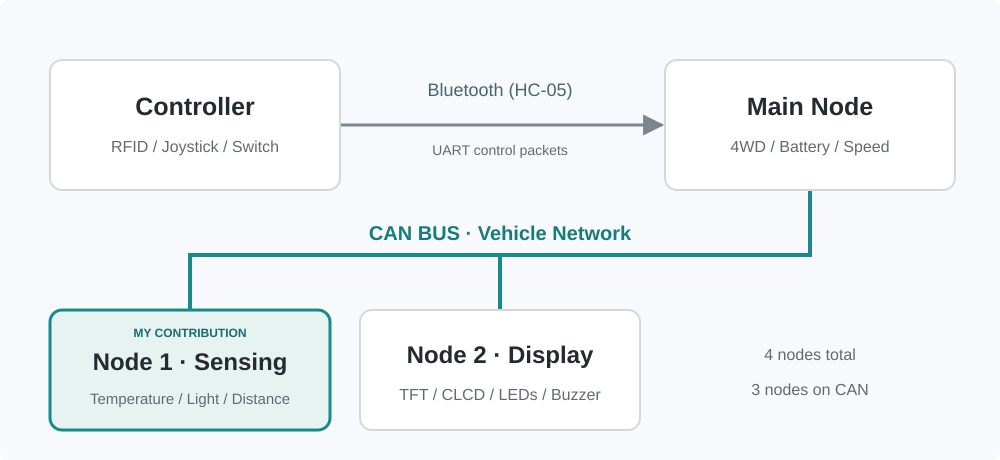

# KICK-CAN · STM32 분산 임베디드 RC카

     

RFID로 사용자를 인증하고, 무선 Controller와 CAN 차량 네트워크를 연결해 주행·센서 감지·상태 표시를 구현한 프로젝트입니다.

**이 저장소는 Node 1의 센서 처리와 CAN 송수신 코드를 다룹니다.**

<p align="center"></p>

| 항목 | 내용 |
|---|---|
| 개발 기간 | 2026.07 |
| 팀 구성 | 4명 · Controller / Main / Sensor / Display |
| Node 1 플랫폼 | STM32F103RBTx / NUCLEO-F103RB |
| 센서 입력 | 전후방 초음파, 온도, 전방·상부 조도 |
| 개발 환경 | C, STM32 HAL, FreeRTOS/CMSIS-RTOS, GCC, CMake, Ninja |
| 통신·주변장치 | CAN, ADC/DMA, TIM3 입력 캡처, GPIO, UART |

## 동작 시연



[▶ 전체 시연 영상 보기 · YouTube](https://youtu.be/I8Ae-Qf42dc)

## 시스템 구성



Controller는 Bluetooth로 Main Node와 연결되고, 차량 내부 Main·Node 1·Node 2는 공통 CAN Bus로 통신합니다.

| 노드 | 역할 | 담당 |
|---|---|---|
| Controller | RFID 인증, 조이스틱·스위치 입력, Bluetooth 명령 송신 | 신동민 |
| Main Node | 무선 명령 처리, 차량 구동, 주행 상태 공유 | 이정훈 |
| Node 1 | 초음파·온도·조도 판단, Task·Queue, CAN 송수신 | 최은비 |
| Node 2 | 표시부·조명·경고 출력 | 최세은 |

## Node 1 처리 흐름

**센서 입력 → 센서별 Task의 상태 판단 → QueueCAN → CAN 송신 Task**

| 구성 | 동작 |
|---|---|
| 센서 Task 4개 | 전방·후방 초음파, 온도, 조도 판단 |
| QueueCAN | 목적지·Command·Value를 송신 Task로 전달 |
| CAN 송신 Task | 초음파 방향 재확인, 프레임 구성, HAL 송신 요청 |
| CAN 수신 | Main Node의 전진·후진·정지 상태 검증·저장 |

초음파 메시지는 전진 시 전방, 후진 시 후방만 전달하며 정지 시에는 제외합니다. 온도·조도에는 이 방향 필터를 적용하지 않습니다.

CAN 송신 확인 범위는 **HAL 요청 등록까지**입니다. Echo 미수신 시 CLEAR는 장애물이 없다는 판정이 아닌 입력 처리 정책이며, CLEAR에도 같은 방향 필터가 적용됩니다.

## 개인 담당

Node 1의 초음파·온도·조도 판단, FreeRTOS Task·Queue 구성과 CAN 송수신을 담당했습니다. Echo 완료 확인·대기와 CLEAR 전달 경로를 수정했습니다.

[개인 구현·문제 해결·확인 범위 보기 →](https://hyaline-52.github.io/kickcan.html)

## 기술 명세

아래 값은 [Node 1 코드 기준 버전](https://github.com/kick-can/Node_1/tree/5ee8840ffca9cf4fd525881378dd5debe1f4fd71)의 설정입니다. 실측 성능 수치와 구분합니다.

<details>
<summary>센서 판단 조건</summary>

| 입력 | 처리 |
|---|---|
| 초음파 1–10 / 11–20 / 21–30cm | 경고 단계 3 / 2 / 1 |
| 유효범위 내 30cm 초과 | CLEAR · Value 0 |
| Echo 미수신·1–400cm 범위 밖 | 코드 정책상 CLEAR · Value 0 |
| Echo 완료 대기 | 최대 30ms |
| 온도 | 30°C 이상 경고, 25°C 이하 정상 복귀 |
| 조도 | 밝음 2500 이상, 어두움 1800 이하 · ADC 값 |

조도는 전방·상부 입력의 변화와 지속 조건으로 판단하고, 빠른 점등 2·완만한 점등 1·소등 0으로 전송합니다.

</details>

<details>
<summary>CAN 메시지 규약</summary>

| 방향 | ID | Command | Value |
|---|---|---|---|
| Main → Node 1 | `0x002` | 60 | 0 전진 / 1 후진 / 2 정지 |
| Node 1 → Node 2 | `0x003` | 110 | 0 정상 / 1 온도 경고 |
| Node 1 → Node 2 | `0x003` | 112 | 0 소등 / 1 완만한 점등 / 2 빠른 점등 |
| Node 1 → Node 2 | `0x003` | 113 | 전방: 0 CLEAR / 1·2·3 경고 단계 |
| Node 1 → Node 2 | `0x003` | 115 | 후방: 0 CLEAR / 1·2·3 경고 단계 |

표준 CAN 프레임·DLC 8을 사용합니다. ID를 논리 목적지로 사용하는 것은 프로젝트 규약입니다.

설계 당시 ICD의 온도 50°C·주행 상태 TURN=3과 달리, 이 Node 1 코드는 온도 30°C 경고·25°C 복귀 및 주행 상태 0·1·2를 처리합니다.

</details>

<details>
<summary>핀맵·주변장치·빌드 설정</summary>

| 입력·출력 | 설정 |
|---|---|
| 전방 / 후방 Trig | PC0 / PC1 GPIO |
| 전방 / 후방 Echo | PA6 TIM3_CH1 / PA7 TIM3_CH2 |
| 전방 / 상부 조도 | PA0 ADC_CH0 / PA1 ADC_CH1 |
| 온도 | PA4 ADC_CH4 |
| CAN RX / TX | PA11 / PA12 |
| 진단 UART2 | PA2·PA3, 115200·8N1 |

ADC는 3채널 scan·DMA 순환 버퍼를 사용합니다. CAN은 APB1 36MHz, prescaler 4, BS1 13TQ, BS2 4TQ로 500kbps 설정입니다.

CMake 3.22 이상, C11, GCC Arm toolchain과 Ninja를 사용하도록 구성되어 있습니다.

```sh
cmake --preset Debug
cmake --build --preset Debug
```

위 명령은 저장소 설정 기준입니다. 보드 업로드·실물 동작 검증과 구분합니다. `.ioc`의 Queue 항목 타입과 생성 코드가 달라 Queue 설명은 `freertos.c`의 `sizeof(CanTxMessage_t)`를 기준으로 합니다.

</details>

## 코드와 설계 자료

| 자료 | 내용 |
|---|---|
| [freertos.c](https://github.com/Hyaline-52/KickCAN-Node1/blob/main/Core/Src/freertos.c) | 센서 Task, QueueCAN, CAN 송신·방향 필터 |
| [main.c](https://github.com/Hyaline-52/KickCAN-Node1/blob/main/Core/Src/main.c) | CAN 수신, 주행 상태, Echo 입력 캡처 |
| [HSI 핀맵](assets/readme/hsi-pinmap.xlsx) | 설계 당시 노드별 핀맵 |
| [ICD 통신 규약](assets/readme/icd.xlsx) | 설계 당시 메시지 정의 |
| [기능 명세](assets/readme/functional-spec.xlsx) | 기능 구성 |
| [팀 Node 1 원본](https://github.com/kick-can/Node_1) | 원본 코드·기여 이력 |
| [Controller 프로젝트](https://github.com/Dongmins11/KickCAN_project_Controller) | 전체 노드 구성과 Controller 구현 |

설계 문서와 실행 코드의 차이는 위 기술 명세에 구분했습니다. Node 2의 표시·경고 출력 완료와 전체 시스템 반복 성공률은 Node 1 코드 확인 범위에 포함하지 않습니다.
