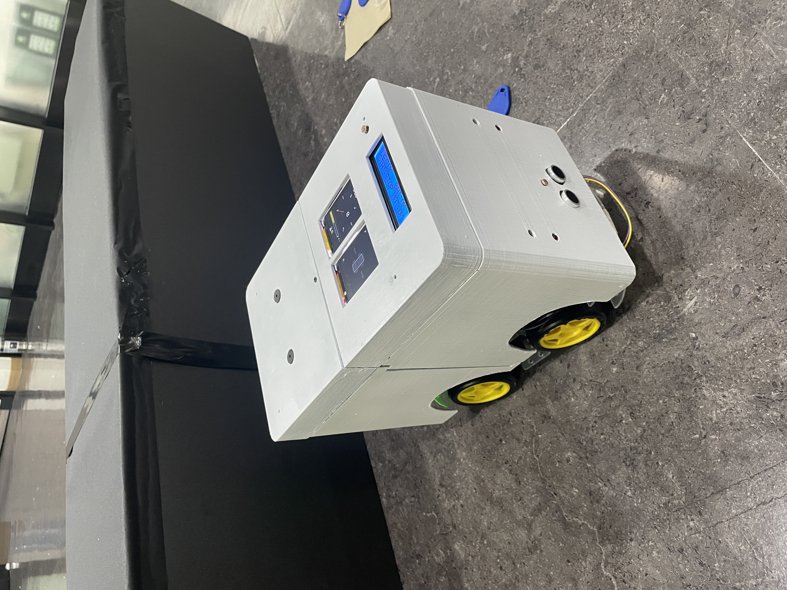
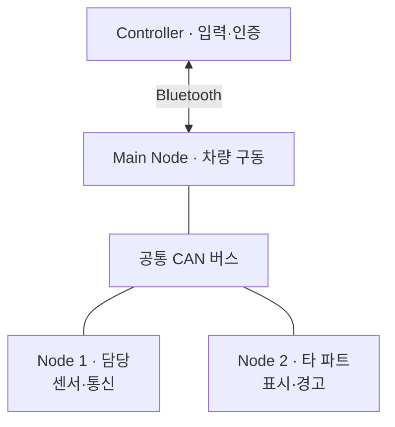
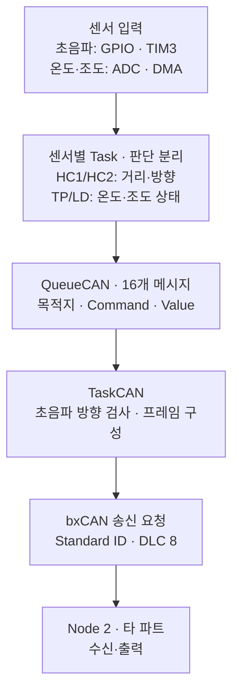
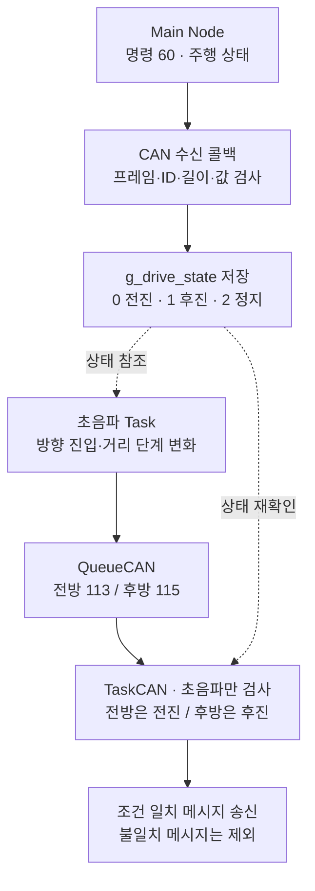

# KickCAN | STM32 기반 센서 처리 및 CAN 통신

> 전후방 거리·온도·조도를 상태로 판단하고, FreeRTOS Task와 QueueCAN을 통해 차량의 표시·경고 노드로 전달한 4인 팀 프로젝트입니다.

팀 전체 RC카 결과물 · 담당: Node 1 센서 판단·Task·Queue·CAN 송수신 차량 구동과 표시·조명·경고 출력은 타 파트 구현입니다.

     

[팀 Node 1 원본](https://github.com/kick-can/Node_1) · [웹 포트폴리오](https://hyaline-52.github.io/kickcan.html)

## 1. Project Overview

KickCAN은 운전자 입력, 차량 구동, 주변 환경 감지, 표시·경고를 여러 제어기에 분담해 CAN으로 연결한 RC카 프로젝트입니다. Node 1은 센서값을 그대로 전달하는 대신, 경고 단계와 점등 요청으로 변환해 출력 노드에 전달합니다.

| 항목 | 내용 |
|---|---|
| 개발 일정 | 2026.07 · 발표자료의 개발 일정 기준 |
| 팀 인원 | 4명 |
| 담당 노드 | STM32F103RBTx / NUCLEO-F103RB 기반 Node 1 |
| 센서 입력 | 전후방 HC-SR04 초음파, 온도, 전방·상부 조도 |
| 개발 환경 | C · STM32 HAL · FreeRTOS/CMSIS-RTOS · GCC · CMake · Ninja |
| 통신·주변장치 | Classic bxCAN · ADC/DMA · TIM3 입력 캡처 · GPIO · UART 진단 출력 |

Git에는 2026.08까지 수정 기록이 있습니다. 위 일정은 실제 종료일·발표일을 확정한 기간이 아닙니다. 아래 코드 설명은 `main`의 [5ee8840 고정 버전](https://github.com/kick-can/Node_1/tree/5ee8840ffca9cf4fd525881378dd5debe1f4fd71)을 기준으로 하며, 실제 최종 시험·제출 버전과의 일치는 별도 확인 대상입니다.

**팀 역할**

- **Controller · 신동민:** RFID 인증, 조이스틱·스위치 입력, Bluetooth 명령 송신
- **Main Node · 이정훈:** 무선 명령 처리, 차량 구동, 주행 상태 공유
- **Node 1 · 최은비 / 담당 파트:** 초음파·온도·조도 판단, Task·Queue, CAN 송수신
- **Node 2 · 최세은:** 수신 상태의 표시·조명·경고 출력

## 2. My Contribution

센서 판단과 CAN 송신을 분리하고, 상태 변화와 주행 방향에 맞춰 메시지를 전달하도록 구현·수정했습니다.

| 담당 영역 | 주요 구현 |
|---|---|
| 센서 처리 | 전후방 Echo 완료 확인·거리 단계 판단, 온도 경고/복귀, 두 조도 입력의 변화·지속 조건 처리 |
| Task·Queue | 센서 Task 4개와 CAN 송신 Task 분리, 목적지·명령·값을 QueueCAN으로 전달 |
| CAN 송수신 | 표준 프레임 구성·송신 요청, Main Node 주행 상태 수신 검증 |
| 방향별 처리 | 전진은 전방, 후진은 후방 초음파 이벤트를 전달하고 송신 Task에서 방향 재확인 |
| CLEAR 수정 | Echo 미수신·범위 밖 입력을 CLEAR 상태로 연결하고 완료 플래그·대기 처리 추가 |

HAL·FreeRTOS 라이브러리와 자동 생성 코드 전체를 직접 작성한 것은 아닙니다. Controller·Main Node·Node 2 구현과 팀 공통 통신 규약 전체의 설계도 개인 단독 기여로 포함하지 않습니다.

## 3. System Architecture

### 3.1 전체 연결 — 공통 CAN 버스

세 차량 노드는 같은 CAN 버스에 연결됩니다. Main → Node 1 → Node 2의 직렬 물리 배선이 아닙니다. 위 그림은 공유 연결 관계이며, 트랜시버·종단저항·배선 길이를 포함한 상세 배선도는 아닙니다.

### 3.2 Node 1 내부 — 판단과 송신 분리

화살표는 논리적 데이터 흐름입니다. 센서 Task는 Queue에 메시지를 넣고, CAN 송신 요청은 `StartTaskCAN()`에서 수행합니다. 온도·조도 메시지는 초음파 방향 검사 대상이 아닙니다. 마지막 화살표는 메시지 목적지이며 실제 수신 성공을 입증하는 시험 결과는 아닙니다.

### 3.3 주행 상태 수신 — 초음파에만 참조

실선은 메시지·처리 흐름, 점선은 저장 상태의 참조입니다. **온도·조도에는 방향 필터를 적용하지 않습니다.** 정지 상태에서는 양쪽 초음파 메시지가 제외되며, CLEAR도 같은 방향 조건을 따릅니다.

## 4. Key Implementation

### 4.1 센서 입력을 상태와 명령으로 변환

**초음파 — 측정 완료와 거리 단계**

`StartTaskHC1/HC2()`에서 Trig를 발생시키고, `HAL_TIM_IC_CaptureCallback()`에서 Echo 시간을 거리로 환산해 완료 플래그를 갱신합니다. Task는 최대 30ms 대기 후 결과를 판단합니다.

| 거리 입력 | 경고 값 |
|---|---|
| 1–10cm | 3 |
| 11–20cm | 2 |
| 21–30cm | 1 |
| 유효범위 내 30cm 초과 | 0 · CLEAR |
| Echo 미수신 또는 1–400cm 범위 밖 | 코드 정책상 0 · CLEAR |

미수신을 CLEAR로 처리하는 것은 입력 예외 처리 정책이며, 실제 장애물이 없다는 측정 결과가 아닙니다.

근거: [전방 Task](https://github.com/kick-can/Node_1/blob/5ee8840ffca9cf4fd525881378dd5debe1f4fd71/Core/Src/freertos.c#L726), [후방 Task](https://github.com/kick-can/Node_1/blob/5ee8840ffca9cf4fd525881378dd5debe1f4fd71/Core/Src/freertos.c#L1065), [입력 캡처 콜백](https://github.com/kick-can/Node_1/blob/5ee8840ffca9cf4fd525881378dd5debe1f4fd71/Core/Src/main.c#L398)

**온도 — 경고와 복귀 조건 분리**

`StartTaskTP()`는 ADC 입력을 필터링하고 TMP36 환산식으로 온도를 계산합니다. **30°C 이상에서 경고, 25°C 이하에서 정상 복귀**하며 상태 변화 시 메시지를 생성합니다. 두 임계값 사이에서는 이전 상태를 유지합니다. 센서 환산식·임계값은 코드 기준이며 실물 센서 모델·보정·정확도 검증과 구분합니다.

근거: [StartTaskTP](https://github.com/kick-can/Node_1/blob/5ee8840ffca9cf4fd525881378dd5debe1f4fd71/Core/Src/freertos.c#L487)

**조도 — 두 입력과 지속 조건**

`StartTaskLD()`는 전방·상부의 raw·필터값과 변화량을 비교합니다. 전방 급감은 빠른 점등, 두 입력의 어두워짐은 완만한 점등 요청으로 연결합니다. 지속 카운터로 짧은 변화와 복귀를 구분하고, 상태가 바뀔 때만 Queue에 전달합니다.

현재 밝음/어두움 기준은 ADC 값 **2500 이상 / 1800 이하**입니다. 내부 상태 enum과 전송 Value는 별도로 매핑하며, 전송 값은 `빠른 점등=2`, `완만한 점등=1`, `소등=0`입니다. 실제 조명 출력은 Node 2 담당입니다.

근거: [StartTaskLD](https://github.com/kick-can/Node_1/blob/5ee8840ffca9cf4fd525881378dd5debe1f4fd71/Core/Src/freertos.c#L1407)

### 4.2 FreeRTOS Task와 QueueCAN

`MX_FREERTOS_Init()`에서 온도·전방 거리·후방 거리·조도 Task를 Normal 우선순위로, CAN Task를 AboveNormal로 생성합니다.

`CanTxMessage_t`는 `uint16_t destination_id`, `uint8_t command`, `uint8_t value`로 구성됩니다. 실제 Queue 생성은 **`xQueueCreate(16, sizeof(CanTxMessage_t))`**입니다.

- 센서 Task: 상태를 판단하고 `xQueueSend(..., portMAX_DELAY)`로 요청 전달
- CAN Task: `xQueueReceive(..., portMAX_DELAY)`로 요청 수신 후 송신 처리
- 인터럽트 콜백: Echo 완료·거리 또는 주행 상태 갱신

Queue로 메시지를 전달하고 공유 `volatile` 상태·완료 플래그를 참조합니다. 별도의 Mutex·Semaphore 동기화를 구현했다고 설명하지 않습니다. Queue가 가득 차면 생산 Task가 대기할 수 있으며, 16개 용량은 처리 성능 측정값이 아닙니다.

근거: [Task·Queue 초기화](https://github.com/kick-can/Node_1/blob/5ee8840ffca9cf4fd525881378dd5debe1f4fd71/Core/Src/freertos.c#L396)

### 4.3 CAN 프레임 구성과 수신 검증

`StartTaskCAN()`은 Queue에서 꺼낸 초음파 메시지의 방향 조건을 확인하고, 목적지 ID를 검사한 뒤 8바이트 프레임을 만듭니다.

| 필드 | 값 |
|---|---|
| 형식 | Standard 11-bit ID · Data Frame · DLC 8 |
| Node 2 목적지 | `0x003` |
| `Data[0]` | Command |
| `Data[1]` | Value |
| `Data[2..7]` | 0 padding |

빈 mailbox를 기다린 뒤 `HAL_CAN_AddTxMessage()`를 호출합니다. 실패 시 진단 로그를 남기며, 애플리케이션 차원의 재등록은 확인되지 않습니다. **HAL 호출 성공은 송신 요청 등록이며 Node 2 수신·출력 완료가 아닙니다.**

수신 콜백은 CAN1, Standard Data Frame, ID `0x002`, DLC 2 이상, 명령 `60`을 검사합니다. `main.h`의 정의에 따라 **0=FORWARD, 1=BACKWARD, 2=STOP**으로 저장하고 다른 값은 기존 상태를 유지합니다. 콜백 안에서 센서 판단·Queue 등록·UART 출력은 하지 않습니다.

근거: [StartTaskCAN](https://github.com/kick-can/Node_1/blob/5ee8840ffca9cf4fd525881378dd5debe1f4fd71/Core/Src/freertos.c#L1792), [CAN 수신 콜백](https://github.com/kick-can/Node_1/blob/5ee8840ffca9cf4fd525881378dd5debe1f4fd71/Core/Src/main.c#L300), [주행 상태 정의](https://github.com/kick-can/Node_1/blob/5ee8840ffca9cf4fd525881378dd5debe1f4fd71/Core/Inc/main.h)

<strong>상세 CAN 메시지 · 명세와 현재 코드의 차이</strong>

명령값은 10진수입니다. CAN ID를 논리 목적지로 사용하는 것은 프로젝트 규약이며 CAN 자체의 목적지 강제 기능은 아닙니다.

| 방향 | ID | Command | Value |
|---|---|---|---|
| Main → Node 1 | `0x002` | 60 | 0 전진 / 1 후진 / 2 정지 |
| Node 1 → Node 2 | `0x003` | 110 | 0 정상 / 1 온도 경고 |
| Node 1 → Node 2 | `0x003` | 112 | 0 소등 / 1 완만한 점등 / 2 빠른 점등 |
| Node 1 → Node 2 | `0x003` | 113 | 전방: 0 CLEAR / 1·2·3 경고 단계 |
| Node 1 → Node 2 | `0x003` | 115 | 후방: 0 CLEAR / 1·2·3 경고 단계 |

[공개 통신 명세](https://github.com/Dongmins11/KickCAN_project_Controller/blob/main/docs/icd.md)에는 온도 경고 50°C와 주행 상태 `TURN=3`이 있지만, 현재 Node 1은 30°C 경고·25°C 복귀 및 주행 상태 0·1·2만 처리합니다. README는 실행 코드를 기준으로 설명합니다.

### 4.4 주행 방향에 맞춘 초음파 이벤트

초음파 Task는 해당 방향으로 진입하거나 거리 단계가 바뀌면 메시지를 구성합니다. Queue 등록 후 주행 상태가 바뀔 수 있어 CAN Task에서 방향을 다시 검사합니다.

- 전방 명령 `113`: FORWARD일 때 허용
- 후방 명령 `115`: BACKWARD일 때 허용
- STOP: 양쪽 초음파 메시지 제외
- 온도 `110`·조도 `112`: 위 방향 필터 적용 없음

CLEAR는 별도의 명령 번호가 아니라 `113/115`의 `Value=0`입니다. 따라서 정지·방향 전환 때 반대 방향 CLEAR가 항상 전달되거나 이전 경고가 자동 해제된다고 보장하지 않습니다.

<strong>핀·주변장치 및 빌드 설정</strong>

| 입력·출력 | 코드 설정 |
|---|---|
| 전방 / 후방 Trig | PC0 / PC1 GPIO |
| 전방 / 후방 Echo | PA6 TIM3_CH1 / PA7 TIM3_CH2 |
| 전방 / 상부 조도 | PA0 ADC_CH0 / PA1 ADC_CH1 |
| 온도 | PA4 ADC_CH4 |
| CAN RX / TX | PA11 / PA12 |
| 진단 UART2 | PA2·PA3, 115200·8N1 |

ADC는 3채널 scan·DMA 순환 버퍼를 사용합니다. CAN은 APB1 36MHz, prescaler 4, BS1 13TQ, BS2 4TQ로 설정되어 500 kbps에 해당합니다. 실제 속도·지연 측정값은 아닙니다.

`.ioc`의 Queue 항목 타입과 실제 생성 코드가 다릅니다. Queue 설명은 `freertos.c`의 `sizeof(CanTxMessage_t)`를 기준으로 합니다. 일부 임계값 주석도 현재 매크로와 달라 코드 값을 우선했습니다.

설정에는 CMake 3.22 이상, C11, GCC Arm toolchain, Ninja Debug/Release preset이 있습니다. `cmake --preset Debug` → `cmake --build --preset Debug`는 설정상 절차이며, 이 문서 정리에서 빌드·플래시를 재검증하지 않았습니다.

[MCU·핀 설정](https://github.com/kick-can/Node_1/blob/5ee8840ffca9cf4fd525881378dd5debe1f4fd71/KickCan_Node1.ioc) · [CAN](https://github.com/kick-can/Node_1/blob/5ee8840ffca9cf4fd525881378dd5debe1f4fd71/Core/Src/can.c) · [ADC](https://github.com/kick-can/Node_1/blob/5ee8840ffca9cf4fd525881378dd5debe1f4fd71/Core/Src/adc.c) · [DMA](https://github.com/kick-can/Node_1/blob/5ee8840ffca9cf4fd525881378dd5debe1f4fd71/Core/Src/dma.c) · [GPIO](https://github.com/kick-can/Node_1/blob/5ee8840ffca9cf4fd525881378dd5debe1f4fd71/Core/Src/gpio.c) · [TIM](https://github.com/kick-can/Node_1/blob/5ee8840ffca9cf4fd525881378dd5debe1f4fd71/Core/Src/tim.c) · [UART](https://github.com/kick-can/Node_1/blob/5ee8840ffca9cf4fd525881378dd5debe1f4fd71/Core/Src/usart.c)

## 5. Troubleshooting

### 초음파 경고 잔류 — Echo 확인과 CLEAR 전달 경로 수정

**문제** — 발표자료 44쪽에는 장애물 감지 메시지만 처리하면 경고 상태가 남는 현상이 기록되어 있습니다. CLEAR를 수신한 출력 노드에서 경고선·색상·경고음을 해제하는 상태 처리가 필요한 팀 통합 문제입니다.

**기존 처리** — 수정 전 초음파 Task는 거리 변수를 읽고 유효범위 밖이면 해당 반복을 건너뛰었습니다. 새 측정의 Echo 완료를 명시적으로 기다리는 경로가 부족했습니다.

**원인 검토** — 감지와 해제의 상태 의미를 송신·수신 노드가 일치시켜야 합니다. Echo 미수신을 경고 잔류의 유일한 원인으로 단정하지 않습니다.

**개인 코드 수정** — [3de71c1](https://github.com/kick-can/Node_1/commit/3de71c1c165f06a80168c9df3ff572a4e397c643)에서 다음을 변경했습니다.

1. 측정 시작마다 Echo 완료 플래그를 초기화하고 최대 30ms 대기
2. 입력 캡처 콜백에서 완료 플래그 갱신
3. Echo 미수신·유효범위 밖 입력을 기존 CLEAR 상태로 연결
4. CAN Task에서 현재 방향과 맞지 않는 초음파 메시지 제외

같은 커밋의 조도 임계값 **밝음 2000→2500, 어두움 1400→1800** 변경은 별도 센서 판단 조정입니다. 초음파 경고 해제 효과의 근거로 연결하지 않습니다.

**확인 결과** — 개인 소스 변경과 `113/115 · Value=0`의 Queue·송신 경로를 확인했습니다. CLEAR 처리를 처음 도입했다기보다, 미수신·범위 밖 입력까지 기존 CLEAR 처리로 연결한 수정입니다.

**검증 한계** — Node 2의 화면·경고음 해제는 타 파트 담당입니다. 최종 실물 경고 해제, 방향 전환·정지 조건, 반복 성공률은 확인되지 않았습니다.

## 6. Results & Verification

| 검⁠증⁠ ⁠구⁠분 | 확인 내용 및 한계 |
|---|---|
| 코⁠드 | 센서 판단, Task·Queue, CAN 프레임 구성·수신 검증, 방향별 초음파 처리. **한계:** 정적 코드 확인. 장비에서 실행한 결과와 구분. |
| 개⁠인⁠ ⁠커⁠밋 | Queue 기반 CAN Task, 주행 상태 수신, Echo 완료·CLEAR·방향 필터 수정. **한계:** 해당 소스 diff 범위. 커밋의 빌드 산출물을 별도 성과로 포함하지 않음. |
| 발⁠표⁠ ⁠기⁠록 | CAN 통합 중 경고 상태 잔류와 CLEAR 해제 처리 필요성. **한계:** 팀의 문제 관측이며 수정 후 합격 기록은 아님. |
| 미⁠확⁠인 | 센서 정확도, Queue 지연, CAN 전달 성공률, 최종 경고 해제·반복 시험. **한계:** 수치·개선율·해결 완료를 주장하지 않음. |

테스트 문서의 **24개 항목은 시나리오 수**이며 24회 시험 또는 24개 합격이 아닙니다. 코드 임계값·대기 시간·통신 설정값도 측정 성능으로 사용하지 않습니다. 개인별 배선·실물 시험 수행 범위와 실제 시험 버전은 추가 확인 대상입니다.

## 7. Code & References

### 코드와 개인 변경

- [freertos.c](https://github.com/kick-can/Node_1/blob/5ee8840ffca9cf4fd525881378dd5debe1f4fd71/Core/Src/freertos.c): 센서 Task, `CanTxMessage_t`, QueueCAN, `StartTaskCAN`
- [main.c](https://github.com/kick-can/Node_1/blob/5ee8840ffca9cf4fd525881378dd5debe1f4fd71/Core/Src/main.c): CAN 초기화·수신, 타이머 입력 캡처 콜백
- [main.h](https://github.com/kick-can/Node_1/blob/5ee8840ffca9cf4fd525881378dd5debe1f4fd71/Core/Inc/main.h): `DriveState_t`
- [8ab06f5](https://github.com/kick-can/Node_1/commit/8ab06f53e81897f6ec9fa8b596ff9c63014878d0): Queue 수신 기반 CAN Task·프레임·HAL 송신
- [67671a6](https://github.com/kick-can/Node_1/commit/67671a6bf2b76707a059aea96b110f9ecb49862f): 주행 상태 명령 60 수신·검증·저장
- [3de71c1](https://github.com/kick-can/Node_1/commit/3de71c1c165f06a80168c9df3ff572a4e397c643): Echo 완료·CLEAR·송신 방향 필터, 별도 조도 임계값 수정

### 문서·관련 자료

- [팀 Node 1 원본 저장소](https://github.com/kick-can/Node_1) — 코드 출처와 기존 기여 이력
- [웹 포트폴리오](https://hyaline-52.github.io/kickcan.html) — 담당 범위와 검증 상태
- [공개 통신 명세](https://github.com/Dongmins11/KickCAN_project_Controller/blob/main/docs/icd.md) — 설계 당시 명세. 현재 Node 1과의 차이는 위에 구분
- 팀 최종 발표자료: 7쪽 역할, 27–32쪽 Node 1, 37–39쪽 CAN, 44쪽 경고 잔류 관측
- 팀 테스트 시나리오: 1–10쪽의 입력·예상 동작. 실행별 PASS/FAIL 기록과 구분

발표자료·테스트 원본의 공개 배포 링크는 확인되지 않아 첨부하지 않았습니다. 대표 사진은 공개 승인된 팀 실물 사진이며, 추가 사진·시연 영상은 포함하지 않았습니다.
